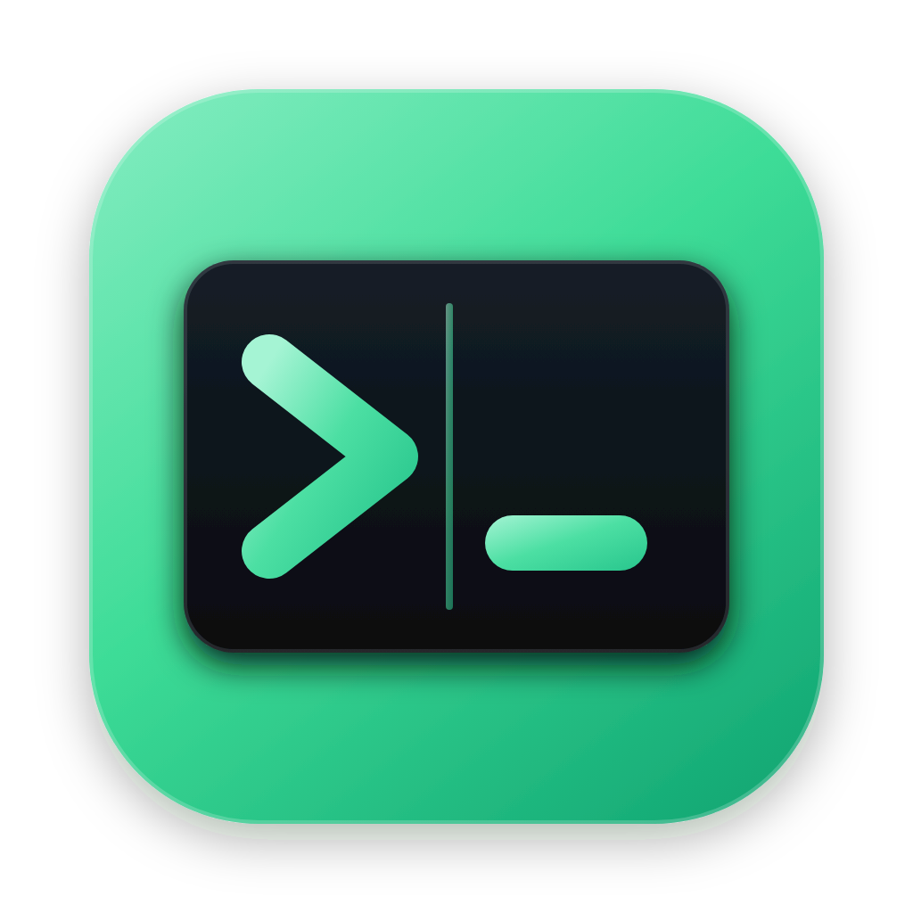

# termix

<p align="center">
  
</p>

<p align="center">
  <strong>A desktop terminal workspace for running several local shells side by side.</strong>
</p>

<p align="center">
  English · <a href="README.zh-CN.md">简体中文</a>
</p>

> Early preview · `v0.1.2`

termix is a desktop app for developers who work in more than one terminal at a time. It keeps every shell local, puts sessions in a clear sidebar, lets you arrange them in split panes, and helps you jump to the right session with search instead of hunting through tabs.

## What you can do

### Run and organize terminal sessions

- Open as many local shells as you need, each in its own PTY; use `Ctrl/Cmd+T` for a new one.
- Switch between sessions from the sidebar or the tab strip.
- Name sessions, follow their current working directory, and see the detected project type at a glance.
- Close a session from its tab, sidebar entry, or context menu.

### Work in split panes

- Show two or more terminals side by side, or above and below one another.
- Drag a session from the sidebar onto a pane edge to place it exactly where you want it.
- Focus, rearrange, or remove a pane from the layout without closing its shell.
- Toggle the split layout from the top-right button or with `Ctrl/Cmd+D`.

### Find a session instantly

- Click the search field or press `Ctrl/Cmd+P`.
- Search by session name or current working directory.
- Results are ranked with exact and prefix name matches first.
- Move through results with `↑` / `↓`, press `Enter` to open one, or click it directly.

### Pin a toolchain to one session

- termix detects common project types, including Go, Node/TypeScript, Deno, Bun, Rust, Python, Ruby, PHP, Java, Swift, Zig, .NET, Dart, Elixir, and Scala.
- If `mise` is installed, choose an already-installed tool version for the current session.
- The rest of your machine keeps its normal tool versions.
- Applying a different version restarts only that session in the same working directory.

### Pick up where you left off

- Restore the open sessions, their working directories, the active session, and toolchain pins on the next launch.
- Remember the light or dark theme and the window size and position.
- Confirm before closing a running terminal; termix also warns when recent output suggests a dev server or file watcher is still running.

## Installation

### Requirements

- **macOS**, **Windows**, or a **Linux desktop**.
- On Linux, **GTK 3** is required. On Debian or Ubuntu:

  ```sh
  sudo apt install libgtk-3-0
  ```

- To use per-session toolchain versions, install **mise** and the tool versions you want. termix lists versions that are already installed.

### Download and install

Download the package for your platform from the [latest release](https://github.com/enolaved/termix/releases/latest).

| Platform | Package |
| --- | --- |
| macOS | `.dmg` — universal build for Apple Silicon and Intel |
| Windows | `-setup-*.exe` — x64 and arm64 builds |
| Linux | `.deb`, `.rpm`, or `.tar.gz` — x64 and arm64 builds |

**macOS**

1. Open the `.dmg`.
2. Drag termix into **Applications**.
3. Open termix from Applications.

**Windows**

1. Run the downloaded setup file.
2. Follow the installer, then open termix from the Start menu.

**Linux**

Install the `.deb` or `.rpm` with your distribution's package manager, or extract the `.tar.gz` and run termix from the extracted folder.

### First launch

Early builds may be unsigned. If macOS refuses to open the app, right-click it and choose **Open**, or allow it from **System Settings → Privacy & Security**. On Windows, if SmartScreen appears, choose **More info → Run anyway**.

