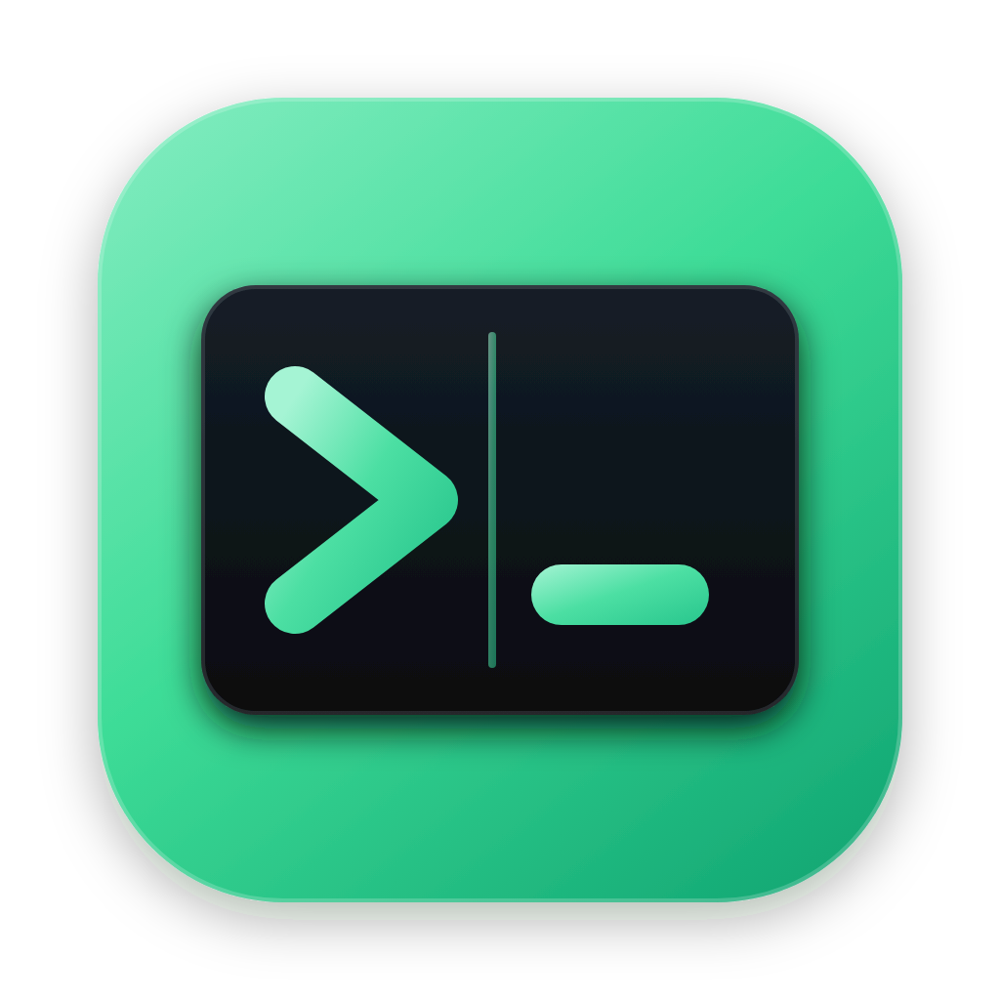

# termix

<p align="center">
  
</p>

<p align="center">
  <strong>一个用于并排运行多个本地 shell 的桌面终端工作区。</strong>
</p>

<p align="center">
  <a href="README.md">English</a> · 简体中文
</p>

> 早期预览版 · `v0.1.2`

termix 是一款面向同时处理多个终端的开发者的桌面应用。所有 shell 都运行在本地；会话在侧边栏中一目了然；可以通过分屏自由排列终端；需要切换时，直接搜索会话名称或路径，不必在标签之间来回寻找。

## 你可以用它做什么

### 运行和整理终端会话

- 按需打开多个本地 shell，每个会话都有独立的 PTY；使用 `Ctrl/Cmd+T` 新建终端。
- 从侧边栏或标签栏快速切换会话。
- 为会话命名，跟踪当前工作目录，并查看自动识别出的项目类型。
- 从标签栏、侧边栏或右键菜单关闭会话。

### 使用分屏工作区

- 将两个或多个终端左右并排，或上下排列。
- 从侧边栏把会话拖到面板边缘，把它放到指定位置。
- 聚焦、重新排列或从布局中移除面板，同时保持对应 shell 继续运行。
- 通过右上角按钮或 `Ctrl/Cmd+D` 切换分屏布局。

### 快速找到某个会话

- 点击搜索框或按 `Ctrl/Cmd+P`。
- 按会话名称或当前工作目录搜索。
- 名称完全匹配或前缀匹配的结果会排在前面。
- 使用 `↑` / `↓` 选择，按 `Enter` 打开，也可以直接点击结果。

### 为单个会话固定工具链版本

- termix 能识别常见项目类型，包括 Go、Node/TypeScript、Deno、Bun、Rust、Python、Ruby、PHP、Java、Swift、Zig、.NET、Dart、Elixir 和 Scala。
- 安装 `mise` 后，可以为当前会话选择本机已经安装的工具版本。
- 机器上的其他项目仍然使用原来的工具版本。
- 应用新版本时，只会让当前会话在同一工作目录中重启。

### 下次打开时继续工作

- 下次启动会恢复打开的会话、工作目录、当前会话和工具链固定项。
- 记住浅色或深色主题，以及窗口尺寸和位置。
- 关闭正在运行的终端前会先确认；如果最近输出中出现开发服务器或文件监听器迹象，还会额外提醒。

## 安装

### 系统要求

- **macOS**、**Windows** 或 **Linux 桌面**。
- Linux 需要 **GTK 3**。Debian 或 Ubuntu 可执行：

  ```sh
  sudo apt install libgtk-3-0
  ```

- 如需为单个会话固定工具链版本，请安装 **mise** 以及需要的工具版本。termix 只会列出本机已经安装的版本。

### 下载与安装

从 [最新版本](https://github.com/enolaved/termix/releases/latest) 下载对应平台的安装包。

| 平台 | 安装包 |
| --- | --- |
| macOS | `.dmg`，同时支持 Apple Silicon 与 Intel |
| Windows | `-setup-*.exe`，提供 x64 与 arm64 |
| Linux | `.deb`、`.rpm` 或 `.tar.gz`，提供 x64 与 arm64 |

**macOS**

1. 打开 `.dmg`。
2. 将 termix 拖入 **应用程序**。
3. 从“应用程序”中打开 termix。

**Windows**

1. 运行下载的安装程序。
2. 按提示完成安装，然后从开始菜单打开 termix。

**Linux**

使用发行版的包管理器安装 `.deb` 或 `.rpm`，或者解压 `.tar.gz` 后从解压目录运行 termix。

### 首次启动

早期版本的安装包可能尚未签名。如果 macOS 拒绝打开应用，可以右键点击并选择 **打开**，或在 **系统设置 → 隐私与安全性** 中允许打开。在 Windows 上如果出现 SmartScreen 提示，选择 **更多信息 → 仍要运行**。
